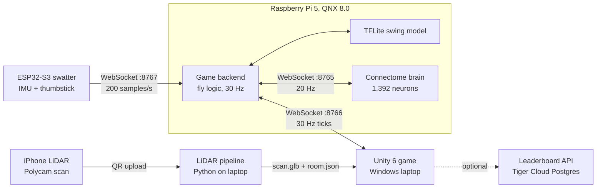

# WhackAFly

**Scan your real room with a phone, pick up a physical swatter, and hunt a virtual fly whose escape reflex runs on neurons mapped from a real fruit fly brain.**

WhackAFly connects five systems into one game: a LiDAR room pipeline, a custom motion controller, an on-device gesture model, a connectome simulation, and a Unity first-person game. The fly's brain and the swing classifier both run on a Raspberry Pi 5 under QNX, the real-time operating system used in many automotive safety systems.

The game also works as a small demonstration of a bigger idea. Drones, robots, and vehicles all need a fast "flinch" when something is about to hit them. A fruit fly solves that problem with a tiny circuit, so we took the wiring of that circuit and ran it as a reflex on inexpensive embedded hardware.

## Contents

- [Highlights](#highlights)
- [How a round plays](#how-a-round-plays)
- [System architecture](#system-architecture)
- [The fly brain](#the-fly-brain)
- [The fly's behavior](#the-flys-behavior)
- [The swatter](#the-swatter)
- [Swing classifier](#swing-classifier)
- [QNX on the Raspberry Pi](#qnx-on-the-raspberry-pi)
- [LiDAR room pipeline](#lidar-room-pipeline)
- [The Unity game](#the-unity-game)
- [Leaderboard](#leaderboard)
- [Running it](#running-it)
- [Testing](#testing)
- [Known limitations](#known-limitations)
- [Repository layout](#repository-layout)
- [Credits and data sources](#credits-and-data-sources)

## Highlights

- **Real fly wiring on a single-board computer.** Pruning the FlyWire connectome to the escape circuit produced a 1,392-neuron, 10,378-connection network that answers on the Pi in a median of 20.4 ms, with a worst case of 40.9 ms across 456 replies against a 50 ms budget.
- **Reliable swing detection from raw motion.** A 5,731-parameter network trained on 159 recorded gestures classified 31 of 32 held-out takes correctly (96.9%), and scored roughly 91 to 95% on people it never saw during training.
- **A model small enough to disappear.** Int8 quantization shrank the classifier to 11 KB with 100% prediction agreement against the full Keras version on the test set.
- **Multi-second lag eliminated.** Trace logging showed Pi to Unity delay climbing to about 7 s under load. Bundling roughly 120 small messages per second into 30 acknowledged ticks cleared the Wi-Fi backlog behind it.
- **A reflex that keeps answering.** During a forced 1.5 s brain stall, a watchdog and lookup table kept 134 of 140 decisions flowing, with a longest silence of 216 ms.
- **Any room becomes a level.** One phone upload generates walls, colliders, lights, sounds, props, and up to 400 validated fly landing spots, with identical output for identical scans thanks to content-seeded placement.
- **A fly that learns your fake-outs, and forgets them.** Modeling synaptic fatigue cut escape strength from 0.90 to 1.00 down to 0.36 to 0.46 after five fake swings, and 6 s of quiet restored its response to breaking glass to 0.88 to 0.98.

## How a round plays

1. Scan a room with a LiDAR iPhone in Polycam's Floorplan mode.
2. Scan the QR code shown by the game and upload the export. The room appears in Unity automatically.
3. Choose a theme (Old House, Medieval, or Futuristic) and a difficulty (Easy, Medium, or Hard).
4. After a 3 second countdown, you have 60 seconds to find and swat the fly.
5. Walk with the swatter's thumbstick, aim by pointing it, and swing it for real.
6. Every prop you smash adds to your damage bill. The leaderboard ranks the lowest bill first, and ties go to the faster swat.

The fly watches and listens the whole time. A swatter growing in its view triggers its eyes, and breaking glass triggers its ears. Blackouts, lightning, headlights, flickering lamps, fog, and your flashlight all change what it can perceive.

## System architecture



**Division of responsibility.** The Pi owns the fly: its personality, senses, decisions, movement, and the round state. Unity draws the world and reports what only a renderer can know, such as brightness at the fly's position, the flashlight beam, room events, clear flight paths, and what the swatter physically touched.

**Ports**

| Port | Protocol | Purpose |
|---|---|---|
| 8765 | WebSocket | Fly brain |
| 8766 | WebSocket | Game backend to Unity |
| 8767 | WebSocket | ESP32 swatter sample stream |
| 8768 | HTTP | Optional leaderboard API |
| 8080 | HTTP | Phone scan upload |
| 9000 | UDP | Optional swatter events |

**Graceful degradation.** Each link has a fallback, so a failed component reduces fidelity and the game keeps running.

| If this fails | The game does this |
|---|---|
| Swatter disconnects | Mouse and keyboard take over |
| Swing model cannot load | Backend uses threshold rules |
| TFLite is unavailable | Same network runs in plain Python from `weights.json` |
| NumPy or live brain is unavailable | Brain answers from a precomputed lookup table |
| Brain misses 2 deadlines in a row | Lookup table answers until 5 on-time replies return |
| Brain process is absent | Fly escapes using a simple rule |
| Pi is unreachable at level load | The same fly runs locally inside Unity |
| Link drops during a round | Unity reconnects and resumes |
| Leaderboard database is down | API returns 503 and the game never waits on it |

## The fly brain

The brain in [`brain/`](brain/README.md) simulates the looming and sound escape pathway from the **FlyWire v783** adult fruit fly connectome, using the model published by Shiu et al. (2024).

### Circuit

- **Eyes:** 314 looming detector neurons (210 LPLC2 and 104 LC4).
- **Ears:** 341 Johnston's organ auditory neurons (JO-A and JO-B).
- **Outputs:** descending neurons DNp01 (the Giant Fiber), DNp02, DNp04, DNp06, and DNp11, one per side.
- **Selection rule:** every neuron on an input to output path of at most 3 synapses, keeping connections of at least the threshold synapse count.

| Network | Min synapses | Neurons | Connections | Notes |
|---|---:|---:|---:|---|
| `subnet_t5` | 5 | 2,264 | 44,662 | Full network, used on the laptop |
| `subnet_t10` | 10 | 1,392 | 10,378 | **Runs on the Pi** |
| `subnet_t20` | 20 | 835 | 1,631 | Smallest, with very weak sound response |

All three ship in the repo at under 360 KB combined, so running the game requires no connectome download. Rebuilding them from the raw 135 MB dataset takes about 9 minutes.

### Neuron model

Each decision simulates 50 ms of leaky integrate-and-fire dynamics in NumPy:

| Parameter | Value |
|---|---|
| Resting and reset potential | -52 mV |
| Spike threshold | -45 mV |
| Membrane time constant | 20 ms |
| Synaptic time constant | 5 ms |
| Refractory period | 2.2 ms |
| Synaptic delay | 1.8 ms |
| Weight | 0.275 mV per synapse |
| Timestep | 0.1 ms (500 steps per decision) |

Looming and sound values become Poisson firing rates on the matching eye or ear neurons. Escape **strength** is Giant Fiber spikes plus half of the other descending neuron spikes, passed through a 100 ms low-pass filter. Escape **direction** comes from a vote between DNp02, DNp04, and DNp11 on each side, because those cells fired only for threats on their own side at every rate and threshold we tested.

### Habituation

Repeat a threat and the fly gradually stops reacting, so players can wear it down with fake swings before committing to a strike. Each sensory channel (left eye, right eye, left ear, right ear) holds a synaptic resource that strong input depletes and that recovers with a 3 s time constant.

Measured in real time on `subnet_t5`, with events 1.5 s apart:

| Scenario | Fresh fly | After repeats |
|---|---|---|
| Breaking glass, 6 times | 0.91 to 0.94 | 0.42 to 0.43 |
| Fake swings, 5 times | 0.65 to 0.72 | 0.33 to 0.34 |
| Real strike | 0.90 to 1.00 | 0.36 to 0.46 |
| Glass after 6 s of silence | | 0.88 to 0.98 |

Only input above 0.4 causes fatigue, so a swatter merely held nearby never dulls the reflex. Fatigue also stays on its own channel, which means noise in the left ear leaves the eyes and right ear at full sensitivity. These parameters were tuned for gameplay and were not fitted to biological recordings.

### Modeling decisions worth noting

- **Giant Fiber sign.** Annotations disagree on the left and right DNp01 transmitters at low confidence (0.32 and 0.27). We treat both as excitatory, matching the known biology and preventing a false left or right bias.
- **Per-eye calibration.** The right eye drives the escape neurons about 1.6 times harder in this data, so calibration scales its input to keep both directions fair.
- **Ear asymmetry.** The right ear has 127 direct synapses onto its Giant Fiber and the left has 14. Matching them requires a large left-ear gain (13.7x on `subnet_t10`), which exceeds real neuron firing rates and exists purely to keep gameplay symmetric.
- **Chemical synapses only.** FlyWire does not include electrical synapses, so the real reflex may be faster or stronger than this model.

## The fly's behavior

[`backend/fly.py`](backend/fly.py) gives each fly a body and temperament around the brain's reflex.

- **States:** perching, grooming, walking along surfaces, flying routes between landing spots, fleeing, and dying.
- **Decisions:** strong brain output triggers takeoff, with side setting the first turn and strength setting speed and distance. Moderate output makes it walk away from the threat.
- **Landing:** the brain and fly logic pick where to go, while the scan's landing spots keep it inside the playable room.
- **Personality:** every round rolls five traits, shown as labels such as "Jittery & Night owl".

| Trait | Easy range | Hard range |
|---|---|---|
| Skittishness | 0.60 to 0.90 | 1.20 to 1.60 |
| Restlessness | 0.50 to 0.80 | 1.40 to 1.90 |
| Night sight | 0.60 to 0.90 | 1.50 to 2.20 |
| Flight pace | 0.65 to 0.90 | 1.25 to 1.60 |
| Hearing | 0.50 to 0.85 | 1.30 to 1.80 |

Medium difficulty picks either range at random for each trait, so its flies can be surprisingly uneven.

## The swatter

The controller is a real fly swatter fitted with:

| Part | Role |
|---|---|
| Seeed XIAO ESP32-S3 | Wi-Fi microcontroller, with external U.FL antenna |
| LSM6DSOX 6-axis IMU | Motion at 208 Hz, ±8 g, ±1000 °/s, over 400 kHz I2C |
| KY-023 thumbstick | Walking, turning, menus, and aim recentering |

The firmware in [`firmware/`](firmware/) streams about 200 JSON samples per second over WebSocket, each with a timestamp, acceleration, rotation, and stick state. Wi-Fi power saving is disabled to keep the stream steady. Since a hard swing can knock the sensor off the I2C bus, the firmware watches for all-zero readings and restarts the link on its own.

Vertical aim comes from gravity, so holding the swatter upright looks straight ahead. Horizontal aim integrates the gyro, and holding the stick press recenters it.

## Swing classifier

[`swatter_ml/`](swatter_ml/README.md) contains the complete record, train, export, and inference pipeline.

**Data.** A guided recorder prompts for swings in six directions at three strengths, along with idle holds, slow aiming, wrist flicks, and bumps. The final set contains 159 takes from multiple people (99 swing, 60 idle), expanded to 1,143 training windows with time-shifted copies. Raw samples stay on disk, so preprocessing can change without re-recording.

**Labels.** Swings and flicks train as `swing`. Idle, aiming, and bumps train as `idle`. A second output head estimates strength from 0 to 10.

**Preprocessing**

1. Resample to exactly 200 Hz with linear interpolation.
2. Compute motion energy as `|gyro| + 0.3 * ||accel| - g|`.
3. Cut an 80-sample (0.40 s) window around the energy peak.
4. Reduce it to 20 blocks of 8 statistics, giving 160 features.

A single shared module handles this for recording, training, and inference, and a test confirms that live and training windows match exactly. Models also store their preprocessing spec, so the runtime refuses any model built for a different one.

**Model.** 160 inputs, Dense 32, Dense 16, then a softmax class head and a sigmoid strength head (5,731 parameters).

| Metric | Result |
|---|---|
| Held-out accuracy (32 takes) | 96.9% |
| Confusion on held-out set | 20/20 swings, 11/12 idle |
| Leave-people-out accuracy | About 91 to 95% |
| Strength error on held-out takes | 1.45 out of 10 |
| Int8 model size | 11 KB |
| Int8 agreement with Keras | 100% |
| Inference time on laptop | 0.03 ms per window |

## QNX on the Raspberry Pi

The backend targets a Raspberry Pi 5 running **QNX 8.0** and Python 3.14, and starts itself at boot. It uses standard library Python throughout, with NumPy and TFLite as optional accelerators.

| QNX feature | How we use it |
|---|---|
| `SCHED_RR` priority scheduling | Configurable real-time priority for the fly loop and brain |
| `slog2` | Connection events, slow brain replies, and late ticks in the system log |
| `pidin` | Live priority and policy reporting through `start.sh status` |
| `ClockPeriod` | Reads the 1 ms kernel tick that bounds timing accuracy |
| `CLOCK_MONOTONIC` | Nanosecond timestamps for deadline checks |
| Deadline monitoring | Per-tick lateness and brain round trip, available through a `stats` message |
| TFLite runtime | On-device inference with `python3-tflite-runtime` 2.21.0 |

Measured on the Pi during 10 s of simulated play with the live brain at priority 20:

| Measure | Median | Tail | Worst |
|---|---:|---:|---:|
| 30 Hz loop lateness (706 ticks) | 1.05 ms | 2.06 ms (p99) | 2.07 ms |
| Brain round trip (456 replies) | 20.4 ms | 33.7 ms (p95) | 40.9 ms |

Sustained play at priority 20 starved the Pi's Wi-Fi and froze the system, so the shipped default is `RT_PRIORITY=0`. The figures above are a short first measurement from that higher-priority configuration.

Porting surfaced a few platform-specific problems. On QNX, `SC_IOV_MAX` reports -1, which broke asyncio socket writes and froze the backend until we patched the WebSocket layer in `brain/ws.py`. Tracing also showed the Pi's Wi-Fi struggling with many small packets, which led to the single-packet tick protocol.

## LiDAR room pipeline

[`lidar/`](lidar.md) turns a Polycam Floorplan export into a playable level.

```text
Polycam GLB or ZIP
  -> server.py          QR code phone upload with token check
  -> process_scan.py    parse, find floor and walls, recenter
  -> placement.py       detect surfaces, place everything
  -> ai_cleanup.py      optional layout review
  -> data/scans/<id>/   scan.glb, room.json, room.rules.json
  -> data/latest.json   Unity notices within a second and loads it
```

Processing covers:

- **Floor and walkability:** finds the main floor outline, keeps holes out of the walkable area, and retries tight rooms with a narrower player body.
- **Surfaces:** classifies floors, ceilings, walls, tabletops, seats, storage, beds, and ledges.
- **Player start:** chooses the point with the most clearance, facing the room center.
- **Lighting:** one ceiling lamp per 35 m² (up to 10), one table lamp per 40 m² (1 to 6), and up to 2 candles.
- **Decor and sound:** about one wall piece per 4.5 m of wall (up to 8), plus 2 or 3 sound sources tied to real objects such as a TV, fridge, or sink when available.
- **Landing spots:** up to 400, each kept only if the player can reach it with the swatter from walkable floor along a clear line.

**Optional AI cleanup.** With `--ai`, Claude reviews a text summary of the room (dimensions, labels, positions) and proposes up to 30 small remove, move, or swap edits. The mesh never leaves the machine. Every edit is rechecked against the placement rules, and any layout that loses more than 5 points of light coverage is rejected in favor of the rule-based result.

## The Unity game

Built with **Unity 6000.0.85f2**, URP 17.0.4, glTFast 6.21.0, and the Input System 1.20.0. No manual scene setup is required, since `RoomLoader` creates itself and builds the whole level at runtime.

- **Themes:** Old House, Medieval, and Futuristic, each with its own textures, props, and mood.
- **Room dressing:** procedural UVs, baseboards, crown molding, stains, scuffs, cobwebs, doors, and a breakable window with rain and a night sky.
- **Atmosphere:** fog, haze, dust, flickering lamps, blackouts, power surges, passing headlights, lightning, film grain, and a vignette that pulses as the fly gets close.
- **Physics and damage:** props knock over, wobble, shatter, and squish, and swatter imprints stay on surfaces (up to 512 per object).
- **Audio:** positional sound, room tone, rain, and ElevenLabs effects. Loud in-game sounds also go to the fly's ears.
- **Neural view:** a live on-screen fly head where each neuron is a dot that flashes red as it fires.

### Controls

| Action | Swatter | Keyboard and mouse |
|---|---|---|
| Walk and turn | Thumbstick | `W` `A` `S` `D` |
| Aim | Point the swatter | Mouse |
| Swing | Swing it | Left click |
| Menu navigation | Thumbstick, press to select | Mouse |
| Recenter aim | Hold stick press | Hold `Space` |
| Clear the fog briefly | | Tap `Space` |
| Turn 180° | | Double tap `Space` |
| Toggle neural view | | `X` |
| Toggle debug camera | | `Tab` |
| Swatter tuning panel | | `F2` |

## Leaderboard

Scores save to a local JSON file by default. An optional service in [`leaderboard/`](leaderboard/server.py) stores every game event in a **TimescaleDB hypertable on Tiger Cloud**, with the leaderboard as a view over round results. The game only talks to this small HTTP API, so database credentials never reach the client. Set `FLYAI_LEADERBOARD` to turn it on.

## Running it

### Requirements

- Windows laptop with Unity 6000.0.85f2 and Python 3.12
- Raspberry Pi 5 with QNX 8.0 and Python 3 (any Linux machine or the laptop also works for development)
- XIAO ESP32-S3, LSM6DSOX, and KY-023 wired together, with PlatformIO
- LiDAR iPhone with Polycam
- All devices on the same Wi-Fi network or hotspot

### 1. Install Python dependencies

```powershell
py -3.12 -m venv .venv
.venv\Scripts\activate
pip install -r brain/requirements.txt -r lidar/requirements.txt
```

Model training needs TensorFlow, so give it a separate environment to protect the brain's NumPy version:

```powershell
py -3.12 -m venv .venv-train
.venv-train\Scripts\pip install -r swatter_ml/requirements.txt
```

### 2. Start the Pi

```sh
sh backend/start.sh          # start the brain and backend
sh backend/start.sh status   # show processes and QNX priorities
sh backend/start.sh logs     # recent events from slog2
sh backend/start.sh stop     # stop everything
```

Useful environment variables: `SUBNET`, `BRAIN_MODE` (`auto`, `live`, `fallback`), `RT_PRIORITY`, and `PRACTICE=1` for free play. The trained model in `swatter_ml/models/latest/` is git-ignored, so copy it to the Pi after training.

### 3. Flash the swatter

Copy `firmware/src/wifi_secrets.example.h` to `firmware/src/wifi_secrets.h`, add your network details, and set `PI_HOST` in `firmware/src/main.cpp` to the Pi's address.

```powershell
cd firmware
pio run -e imu_test -t upload
```

Leave the thumbstick untouched while the board boots.

### 4. Launch the game

1. Open `WhackAFlyGame` in Unity Hub.
2. Set `FLYAI_BACKEND=ws://<pi-ip>:8766` before launching Unity.
3. Open `Assets/Scenes/SampleScene` and press Play.
4. Use the main menu to upload a scan by QR code, or pick an existing level.

To test without the Pi, run the backend locally and point `FLYAI_BACKEND` at `ws://127.0.0.1:8766`.

### Train your own swing model

```powershell
.venv\Scripts\python -m swatter_ml.record --person yourname
.venv-train\Scripts\python -m swatter_ml.train
```

### Process a scan without the phone

```powershell
python lidar/ingest.py path\to\scan.glb
```

## Testing

```sh
python3 backend/test_backend.py              # protocol, rounds, stream, and fly logic
python  -m unittest swatter_ml.test_swatter_ml -v
python  leaderboard/test_server.py
python  brain/bench.py all                   # full brain benchmark suite
python  brain/bench.py speed                 # compare subnetworks on the current device
```

Selected brain results on the laptop with `subnet_t5`:

| Test | Result |
|---|---|
| Looming latency at 20 Hz | 401/401 answered, p50 16 ms, p95 21 ms |
| Mixed looming and sound | 400/400 frames, 0 duplicate replies, p95 28 ms |
| Malformed input | All 25 cases handled without a crash |
| Fallback accuracy against live brain | Within 0.11 strength |
| Abrupt client crashes | Clean recovery from 10 of 10 |
| 90 s soak | Memory flat at 58 MB |

## Known limitations

- **The eyes are simulated.** The looming signal comes from the swatter's position in the game. The reflex circuit is real connectome data, and no camera feeds it.
- **Swing to screen takes about 155 to 216 ms.** Around 135 ms of that is the classifier waiting for the end of its post-peak window.
- **Bumps are the weakest class.** About half of deliberate bumps still register as swings, and more bump recordings would help.
- **The Pi's Wi-Fi driver can hang** during long sessions and needs a power cycle to recover.
- **Real-time priority is off by default** because priority 20 starved the Wi-Fi stack.
- **Only one Unity client** should connect to the Pi, since a second one resets the shared round.
- **The fallback table comes from `subnet_t5`** while the Pi runs `subnet_t10`, so their group labels differ at positions 4 to 7. `brain/build_lookup.py` can rebuild it.
- **Sound tops out near 0.78 strength** on `subnet_t10`, below the full-strength response of the larger network.
- **Two backend tests fail on Windows** (the stats rate check and the data collector test). The other 63 pass.

## Repository layout

```text
.
├── backend/          Pi game server, fly behavior, gesture stream, QNX helpers
├── brain/            Connectome extraction, simulation, calibration, brain server
│   └── subnet/       Prebuilt networks and fallback lookup table
├── firmware/         ESP32-S3 swatter firmware and test sketches
├── swatter_ml/       Gesture recording, training, export, and inference
├── lidar/            Scan upload, room analysis, placement, AI cleanup
├── leaderboard/      Optional scores and event API on Tiger Cloud
├── sfx/              Sound effect clips and generation script
├── unity-scripts/    Source of truth for the game's C# scripts
├── WhackAFlyGame/    Unity project, art, and compiled copy of the scripts
├── lidar.md          Detailed LiDAR documentation
├── unity.md          Detailed Unity documentation
└── qnx.md            QNX track notes
```

The codebase holds about 10,700 lines of Python, 12,200 lines of C#, and 700 lines of C++. When changing game code, edit `unity-scripts/FlyAI/` and copy it into `WhackAFlyGame/Assets/FlyAI/`, keeping both versions in sync.

## Credits and data sources

- **Connectome:** [FlyWire](https://flywire.ai) v783 and its neuron annotations.
- **Neuron model and connectivity data:** Shiu et al., 2024, *A Drosophila computational brain model reveals sensorimotor processing*, Nature.
- **Textures:** [ambientCG](https://ambientcg.com), CC0.
- **3D models:** [Poly Haven](https://polyhaven.com), CC0. See [`CREDITS.txt`](WhackAFlyGame/Assets/FlyAI/Art/CREDITS.txt).
- **Sound effects and announcer:** generated with [ElevenLabs](https://elevenlabs.io).
- **Room scanning:** [Polycam](https://poly.cam).
- **Built with:** Unity, QNX, TensorFlow Lite, NumPy, PlatformIO, TimescaleDB on Tiger Cloud, and Claude.

Built at Hack Western.
